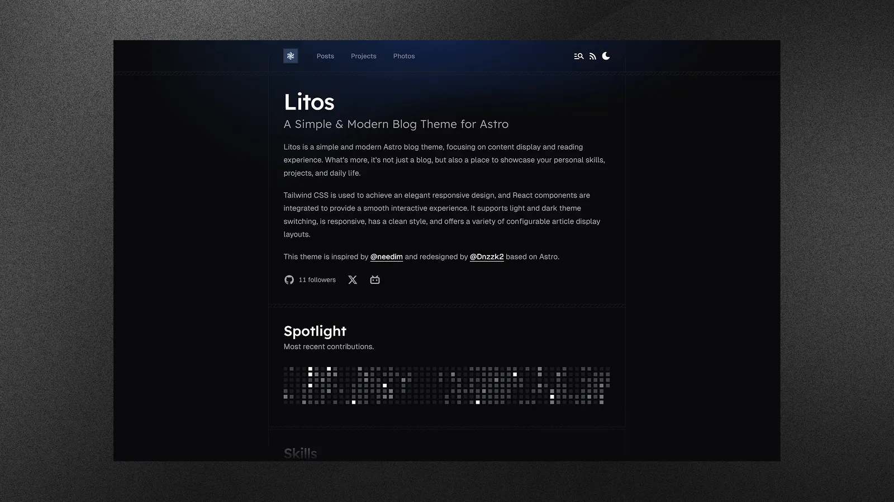

<div align="center">


**Public ndEX funnel and customer-facing builder surface for Spotren.**

**English**

[Report Bug](https://github.com/Spotren/spotren-sites/issues) · [Request Feature](https://github.com/Spotren/spotren-sites/issues)

</div>

## Introduction

`ndEX-builder` is the public Spotren surface that helps turn a Google Maps business profile into a guided site-building and checkout journey.

It is built with **Astro**, **React**, and **TailwindCSS**, but its role is operational, not just visual:

- resolve a public Google Maps business profile URL
- create or reuse a Spotren prospect
- issue a signed public session token
- list active Spotren site templates
- create seller and customer checkouts
- expose post-checkout status surfaces such as `my-site` and `pay-ok`



## Key Features

- **Public Prospect Flow** — turns a Google Maps business profile URL into a Spotren prospect and signed public session.
- **Template Selection** — loads active Spotren site templates from the product backend.
- **Checkout Handoff** — creates seller and customer checkout flows tied to the selected template and prospect.
- **Post-Checkout Surfaces** — provides `my-site` and `pay-ok` views backed by public Spotren API routes.
- **Localized Astro UI** — localized content-driven pages under `src/content/site/*`.
- **Content + Editorial Pages** — still supports posts, projects, cases, and supporting editorial content.
- **Performance-Oriented Frontend** — Astro 5 + React 19 + TailwindCSS 4.

## What This Project Is Not

This project is not:

- the authenticated Spotren workspace app
- the managed site provisioning worker
- the provisionable customer site template itself

Those responsibilities live in `spotren-app/` and `spotren-templates/`.

## Getting Started

### Prerequisites

- **Node.js** (v18 or higher)
- **pnpm** (recommended)

### Installation

1.  **Clone the repository**

    ```bash
    git clone https://github.com/Spotren/spotren-sites.git
    cd spotren-sites/ndEX-builder
    ```

2.  **Install dependencies**

    ```bash
    pnpm install
    ```

3.  **Start the development server**

    ```bash
    pnpm dev
    ```

    Your site should now be running at `http://localhost:4321`.

## Configuration

The public UI configuration lives mainly in:

- `src/config.ts`
- `src/content/site/en.json`
- `src/content/site/pt.json`

The operational integration points come from public environment variables.

### Public API Environment Variables

The main public routes used by this project are configured through `.env` values such as:

- `PUBLIC_SPOTREN_CREATE_PROSPECT_URL`
- `PUBLIC_SPOTREN_PROSPECT_DETAIL_URL`
- `PUBLIC_SPOTREN_PAY_OK_DETAIL_URL`
- `PUBLIC_SPOTREN_SITE_TEMPLATES_URL`
- `PUBLIC_SPOTREN_CREATE_CHECKOUT_URL`
- `PUBLIC_SPOTREN_STATIC_MAP_URL`
- `PUBLIC_SPOTREN_TURNSTILE_SITE_KEY`

These routes are currently served by:

- `spotren-app/apps/web/app/api/public/spotren-sites/*`

### Public Flow Pages

- `/`
  - Google Maps entry point and public ndEX overview
- `/new-site`
  - public session-based site creation and checkout selection
- `/my-site`
  - public follow-up surface for the seller journey
- `/pay-ok`
  - public follow-up surface for the customer payment journey

### Content Model

Unlike `spotren-templates/ndEX`, this project uses localized content files under:

- `src/content/site/en.json`
- `src/content/site/pt.json`

The content schema is validated in:

- `src/lib/site-schema.ts`

### Relation To Other Repositories

- `spotren-sites/ndEX-builder`
  - public funnel UI
- `spotren-app`
  - public route behavior and integrations backend
- `spotren-templates/ndEX`
  - provisionable customer site template contract

## Scripts

| Script | Description |
| :--- | :--- |
| `pnpm dev` | Starts the local development server. |
| `pnpm build` | Builds the site for production. |
| `pnpm preview` | Previews the built production site locally. |
| `pnpm format` | Formats code using Prettier. |
| `pnpm check` | Runs Astro check for diagnostics. |

## Architecture Notes

- Public sessions are signed and are required to bridge anonymous users into prospect-specific actions.
- Template selection in this UI is advisory until the backend accepts the chosen `siteTemplateId`.
- Checkout creation does not provision the managed site directly from this repository.
- Managed provisioning and deploy are documented in `spotren-app/docs/architecture/`.

## License

Distributed under the MIT License. See [MIT LICENSE](LICENSE) for more information.

## Star History

<a href="https://www.star-history.com/#Spotren/spotren-sites&type=date&legend=top-left">
 <picture>
   <source media="(prefers-color-scheme: dark)" srcset="https://api.star-history.com/svg?repos=Spotren/spotren-sites&type=date&theme=dark&legend=top-left" />
   <source media="(prefers-color-scheme: light)" srcset="https://api.star-history.com/svg?repos=Spotren/spotren-sites&type=date&legend=top-left" />
   
 </picture>
</a>

---

<p align="center">
made with 💗 by <a href="https://github.com/Dnzzk2">Dnzzk2</a> !
</p>
